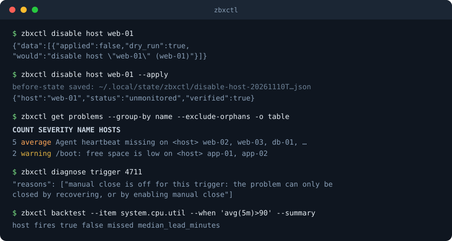

# zbxctl

**A Zabbix command line built for both people and AI agents.** Predictable subcommands, flat JSON output, structured errors, and a dry run for every change. One static binary, no runtime dependencies.

<p align="center"></p>

- **Safe by default.** Reads change nothing. Every write is a dry run until you add `--apply`, and bulk writes check the whole target list first, save an audit file, and verify the result.
- **Made for scripts and agents.** JSON by default, flat objects with readable values (`"status": "monitored"`), stable exit codes, and a machine-readable description of every command (`zbxctl llm capabilities`). An MCP server is built in.
- **Answers questions, not just API calls.** `diagnose trigger` explains why a problem is stuck, `get problems --group-by name` collapses alert storms, `backtest` replays an alert idea against your history and tells you how often it would have been right.
- **Zabbix 7.4 and newer.** Detects the server version, or pin it per connection.

## Contents

[Install](#install) · [Quick start](#quick-start) · [Safe by default](#safe-by-default) · [Commands](#commands) · [Recipes](#recipes) · [For agents (llm manifest, MCP)](#for-agents) · [Configuration](#configuration) · [Output and exit codes](#output-and-exit-codes) · [Zabbix versions](#zabbix-versions) · [Development](#development) · [License](#license-and-notices)

## Install

**From a release** (Linux, macOS, Windows; amd64 and arm64): download the archive for your platform from the [Releases](../../releases) page, check it (below), and put `zbxctl` on your `PATH`. Each archive also contains `LICENSE` and `THIRD_PARTY_NOTICES.md`.

**From source** (Go 1.25 or newer):

```sh
git clone https://github.com/mwtrigg/zbxctl
cd zbxctl
make build            # or: CGO_ENABLED=0 go build -o zbxctl ./cmd/zbxctl
```

### Check what you downloaded

Every release has a `checksums.txt` and a signature of it, `checksums.txt.sig`, made with the project's release key ([`docs/release-signing-key.pub`](docs/release-signing-key.pub)).

```sh
# 1. the signature on the checksums (OpenSSH 8.0 or newer)
echo "zbxctl-release $(cat docs/release-signing-key.pub)" > allowed_signers
ssh-keygen -Y verify -f allowed_signers -I zbxctl-release -n zbxctl-release \
           -s checksums.txt.sig < checksums.txt

# 2. the archive against the checksums
sha256sum --check --ignore-missing checksums.txt
```

Release files also carry GitHub build-provenance attestations, so `gh attestation verify zbxctl_<version>_linux_amd64.tar.gz --repo mwtrigg/zbxctl` proves which workflow and commit built them.

### Updating

`zbxctl upgrade --check` says whether a newer release exists. `zbxctl upgrade` downloads it and installs it only if the signature on `checksums.txt` is valid for the release key built into your copy and the archive matches its checksum. It downloads only from this project's release page, never installs an older version than the one running (the version is part of the signed archive name, so an old release cannot be passed off as a new one), and keeps the previous binary as `zbxctl.old`. If anything cannot be verified it installs nothing.

## Quick start

Create `~/.config/zbxctl/config.yaml` (see [Configuration](#configuration) for everything it can hold):

```yaml
current_context: lab
contexts:
  lab:
    url: https://zabbix.example.com
    api_token: "<your API token>"     # or point ZBXCTL_API_TOKEN at it
```

Then:

```sh
zbxctl auth status                                  # who am I talking to, and is it supported
zbxctl get hosts --group "Linux servers" -o table
zbxctl get problems --severity high --since 24h        # --severity is a minimum
zbxctl diagnose host web-01                         # one call: problems, events, data, broken items
```

## What this protects, and what really enforces access

zbxctl is a **guardrail**, not a security boundary. The dry run, the permission tiers, the audit trail,
the `run script` allowlist and the MCP server's tool list exist to stop mistakes: yours, a script's, an
agent's confused or misled step. They are checked by zbxctl, which runs as your user and reads your config
and token. Anything else that runs as your user (an agent with a shell, a script, `curl`) can skip zbxctl
and call the Zabbix API with the same token. So:

- **Real enforcement is the Zabbix side**: the role and the user group rights of the user the token
  belongs to. Zabbix refuses what that user may not do, whatever client asks.
- **Give agents their own token**, of a user with the **User** role whose user groups have **read-only**
  access to the host groups it should see. Keep Admin and Super admin tokens out of any context an agent can
  use. In the config, label that context `permissions: readonly`.
- **`zbxctl auth check`** reads the token's role (it changes nothing) and warns when the tier you declared
  is stronger than what Zabbix enforces, for example a `readonly` context whose token is a Super admin.

| Zabbix role of the token's user | What Zabbix lets it do | Matching zbxctl tier |
|---|---|---|
| **User**, groups with read-only rights | read what those groups hold; acknowledge, suppress and comment on problems if the role allows it; no configuration changes | `readonly` (or `operator` if it should acknowledge) |
| **User**, groups with read-write rights | the above, and change the objects of those groups only where the role allows | `operator` |
| **Admin** | change the configuration of the groups it has read-write rights to (hosts, items, triggers, templates it can reach), not users or global settings | `write` |
| **Super admin** | everything, including users, tokens, scripts and settings | `write`, with care |

zbxctl's tier can be *weaker* than the role (a Super admin token in a `readonly` context stops zbxctl from
writing, and only zbxctl) but never stronger: it cannot give a token powers Zabbix has not granted.

## Safe by default

| What you do | What happens |
|---|---|
| Any `get`, `diagnose`, `backtest`, `state`, `diff` | Reads only. Nothing changes. |
| Any command that changes something | A **dry run**: it prints what it would do and exits 0. Add `--apply` (or `-y`) to do it. People who find that tedious can set `mode: apply` for a connection (below); `--dry-run` then previews a single command. |
| A change to several targets | Every target is resolved first, so a typo changes nothing. `--expect N` refuses to run unless exactly N targets resolve. `--id-file` reads targets from a file. |
| `--apply` on a change | Saves a **before-state file** (what was done, what the target looked like before), applies the changes one by one, then re-reads each target to **verify** it. |
| `delete user` | Refuses `Admin` and the user that owns the credentials in use. |
| Secrets | Passwords and secret macro values come from a file or stdin, never a flag; secret values are never printed or saved. |
| `run script` | Opt-in per context (`allowed_scripts`), operator tier, the script pinned to its whole definition (`name@sha256:<hash>`: command, where it runs, parameters, user; an edited script is refused, and so is one that uses `{$MACROS}`), and a one-time code typed at a terminal. It stops accidents and casual automation; **it is not a barrier against a program running as your user**, which can allocate a terminal and type the code back. Do not set `allowed_scripts` on a context an agent can use. The MCP server does not offer it. |

**Applying by default.** The dry run is the right default for agents and for a first look, and tedious for a person who knows what they are doing. For a connection you trust, set `mode: apply` in the config (or `ZBXCTL_MODE=apply`): changes then happen without `--apply`, and `--dry-run` previews one command. Everything else still protects you: bulk targets are all resolved first, `--expect` still guards, the before-state file is still saved and the result is still verified, `delete user` still refuses `Admin`, and `run script` still needs its allowlist and confirmation code. `state prune` deletes audit files, so it always needs an explicit `--apply`. `zbxctl auth status` shows the mode of the connection in use. **The MCP server ignores this setting**: an agent calling it always gets a dry run unless it passes `apply: true`.

Permission tiers cap what a connection may do: `permissions: readonly | operator | write` in the config. A tier includes the ones below it; a misspelt tier is a config error, never full access.

| Tier | Allows |
|---|---|
| `readonly` | every `get`, `diagnose`, `export`, `state list/show`, `api call` for read methods; nothing that changes Zabbix |
| `operator` | the above, plus day-to-day operations: `enable` / `disable` host or trigger, `acknowledge` / `unacknowledge` / `suppress` / `unsuppress`, `maintenance create` / `extend` / `shorten` / `delete`, and `run script` (still behind its pinned allowlist) |
| `write` (the default when `permissions` is not set) | everything else: create, update and delete hosts, templates, groups, items, triggers, macros, value maps, regular expressions and users, tags, `import`, and `api call` writes |

### The audit trail

Every change made with `--apply` saves a before-state file under `~/.local/state/zbxctl/`. Together they are an audit trail of what zbxctl changed, and they give you (or an agent) what is needed to undo a change by hand:

```sh
zbxctl state list --command delete-host     # newest first
zbxctl state show delete-host-20261110T031907Z.json
zbxctl state prune --older-than 90d         # a dry run until --apply
zbxctl state prune --keep 50                # or: keep only the newest 50
```

There is deliberately no automatic restore: too much can go subtly wrong (a deleted host's history is gone, secret values are never saved, a closed problem cannot be reopened). The table below says how to reverse each kind of change by hand. Turn the files off with `before_state: false` in the config, `ZBXCTL_BEFORE_STATE=false` or `--no-state`; `state_dir` / `ZBXCTL_STATE_DIR` / `--state-dir` choose where they go. zbxctl keeps the newest **200** files and deletes older ones as new ones are written (it says so on stderr when it does); change that with `state_keep` in the config, `ZBXCTL_STATE_KEEP` or `--state-keep`, and use `0` to keep everything. Only files zbxctl wrote are ever touched.

| Change | What the file holds | Undo |
|---|---|---|
| `enable` / `disable` host or trigger | the status before | the opposite command on the same target |
| `acknowledge` / `unacknowledge` | whether it was acknowledged and closed | the opposite verb (a closed problem cannot be reopened) |
| `suppress` / `unsuppress` | the event | the opposite verb (an earlier suppression time is not recorded) |
| `maintenance extend` / `shorten` | the end time before | `maintenance extend\|shorten --until <the old end>` |
| `maintenance delete` | name, start, end, hosts, groups | `maintenance create` with those values |
| `update host` | name, description, groups, templates (names and IDs), monitoring source | `update host` with the old values; `--clear-template` also deletes items and history, which no file can bring back |
| `delete host` | groups, templates, tags, macros (secret values excluded), description, monitoring source, and every interface with its type, address, port and SNMP setup (secrets masked) | `create host`, then `update host` and `set macro`; history is gone |
| `delete template` | the full yaml export | save `export_yaml` to a file, then `import template <file> --apply` |
| `import template\|host` | the previous yaml export of every object it changed | import that yaml again (objects the import created are not recorded) |
| `delete group`, `item`, `trigger`, `macro`, `valuemap`, `regexp`, `user`, `usergroup` | the object's fields | the matching `create` / `set` command with those fields |
| `update item`, `trigger`, `group`, `valuemap`, `regexp`, `set macro`, `tag` / `untag host` | the object as it was (a secret macro's value is never returned by Zabbix, so it cannot be saved) | the same `update` / `set` command with the old values |
| `create ...` | what was requested, and the command that undoes it | the `delete` command named in the file |
| `delete lost items\|triggers` | what was deleted | nothing to restore: discovery recreates them if the object comes back |

Do the undo as a dry run first and check it against the file.

## Commands

Everything below is a dry run unless it is a read. `zbxctl <command> --help` has the flags; `zbxctl llm capabilities` lists them all as JSON.

**Read**

```
get hosts | host | items | latestdata | history | trends | interfaces | macros
get triggers | problems | events | alerts | auditlog
get templates | template | groups | users | user | usergroups | scripts | actions
get proxies | proxy-groups | valuemaps | regexps | discovery | lost items | lost triggers
diagnose host <host>        diagnose trigger <id> | <event> --event
backtest --item <key> --when '<condition>'
auth status | context list | context use <name>
```

**Change** (each takes `--apply`)

```
enable | disable   host | trigger
acknowledge | unacknowledge | suppress | unsuppress   <event-id>...
maintenance create | extend | shorten | delete
create | update | delete   host | group | item | trigger | valuemap | regexp
create | delete   user | usergroup
set macro | delete macro        (host or --global)
tag host | untag host
update host --proxy <name|none> | --proxy-group <name> | --add-template | --remove-template (unlink; items stay) | --clear-template (unlink and delete what it gave the host)
export | diff | import   template | host
delete template | delete lost items | delete lost triggers
run script <name> --host <host>        (pinned allowlist, operator tier and a typed code; see the note on what that does and does not stop)
api call <method> --params '{...}'     (escape hatch: reads run with secrets masked; writes are a dry run, and user/token/script/action/role/usergroup/authentication/userdirectory/mediatype writes need api_call_admin: true)
```

Handy flags on list commands: `--filter KEY=VALUE`, `--field NAME` (one value per line, for shell use), `-o json|jsonl|table|csv`, `--since 7d` (relative times work everywhere), `--tz America/New_York`.

## Recipes

**Triage a storm of alerts**

```sh
zbxctl get problems --exclude-orphans --group-by name --since 7d -o table
zbxctl diagnose trigger 126 --event      # why is this one still open? can it recover?
```

`--exclude-orphans` drops problems that can never recover (the trigger, host or items behind them are disabled). `--group-by name` collapses the same alert across hosts into one row with a count and the event IDs.

**Change many things safely**

```sh
printf 'web-01\nweb-02\nweb-03\n' > hosts.txt
zbxctl disable host --id-file hosts.txt --expect 3          # dry run: shows all three
zbxctl disable host --id-file hosts.txt --expect 3 --apply  # saves a before-state file, verifies each
```

**A maintenance window you can stretch**

```sh
zbxctl maintenance create --name "Patching" --host web-01 --duration 2h --apply
zbxctl maintenance extend "Patching" --by 1h --apply
```

**Would this alert have been a good idea?**

```sh
zbxctl backtest --host web-01 --item system.cpu.util --when 'avg(5m)>90' --since 30d \
                --real-problem "CPU is high" --summary
```

Conditions: `last>90`, `avg(5m)>90`, `min(10m)>=80`, `max(1h)<5`, `nodata(10m)`, or an expression that compares items and shares of them, for example a memory-drop rule: `(max(15m) - last) > 10% of last("vm.memory.size[total]") AND last("vm.memory.size[pavailable]") < 50`. With `--real-problem` (or `--real-event`) each fire is judged against real problems on the same host: a true alert with its lead time in minutes, a false alarm, or a problem it missed. `--source trends` replays a year of hourly data.

**History and trends**

```sh
zbxctl get history --host web-01 --item system.cpu.util --since 7d --gaps-over 10m   # silences
zbxctl get trends  --host web-01 --item system.cpu.util --since 365d --rollup day -o csv
```

**Move monitoring, clean up discovery**

```sh
zbxctl update host web-01 --proxy proxy-eu-1 --apply
zbxctl get lost items --host web-01
zbxctl delete lost items --host web-01 --expect 3 --apply     # only objects discovery has lost
```

## For agents

- **`zbxctl llm capabilities`** prints every command as JSON (flags, examples, output fields, a `dangerous` marker); `zbxctl llm schema <command>` prints one. Neither needs credentials or a network.
- **Output is predictable**: JSON by default; list commands wrap results as `{"data": [...], "meta": {"count": N, "command": "..."}}`; errors go to stderr as `{"error": "...", "kind": "...", "code": N}`.
- **An MCP server is built in.** `zbxctl mcp` serves the commands as [MCP](https://modelcontextprotocol.io) tools over stdio. Each tool call runs zbxctl itself, so the Zabbix URL and token come from your config or environment and never pass through the agent:

  ```json
  {"mcpServers": {"zabbix": {"command": "zbxctl", "args": ["mcp"], "env": {"ZBXCTL_CONTEXT": "lab"}}}}
  ```

  The MCP server is a convenience and a set of guardrails, not an access control (see [What this protects](#what-this-protects-and-what-really-enforces-access)): an agent that can run commands as you can skip it. Use a least-privilege token for the context it uses. By default only commands that cannot change anything are offered. `--allow-writes` adds the write commands, and each is still a dry run until the call passes `apply: true` (even if your config says `mode: apply`). Never offered: `run script`, `api call`, `upgrade`, `context use`, `state prune`, and anything that works on a file path. Results are marked as untrusted data, and the arguments an agent sends are positional values only, so they cannot turn into flags by accident.

## Configuration

`~/.config/zbxctl/config.yaml` (see [`docs/config.example.yaml`](docs/config.example.yaml)). Each context is one Zabbix server; pick one with `-c <name>`, `ZBXCTL_CONTEXT`, or `zbxctl context use <name>`.

```yaml
current_context: lab
contexts:
  lab:
    url: https://zabbix.example.com
    api_token: "<your API token>"   # or username/password; the token is preferred
    tls_verify: true
    ca_file: ""                     # trust a custom CA
    proxy: ""                       # an HTTP proxy for this server
    default_limit: 100
    api_version: ""                 # pin e.g. "7.4" or "8.0"; empty = detect
    mode: dry-run                   # dry-run (default) or apply: what a change does without --apply/--dry-run
    permissions: write              # readonly | operator | write
    allowed_scripts: []             # what `run script` may execute, as name@sha256:<hash of the definition>; empty = blocked (a refusal prints the entry to add)
    api_call_admin: false           # true lets `api call` write user, token, script, action, role... objects
    before_state: true              # audit files for changes made with --apply
    state_dir: ""                   # empty = ~/.local/state/zbxctl
    state_keep: 200                 # keep this many audit files, delete older ones; 0 = keep all
```

Priority for every setting: command-line flag, then environment variable, then the config file, then the default.

| Variable | Meaning |
|---|---|
| `ZBXCTL_URL`, `ZBXCTL_API_TOKEN`, `ZBXCTL_USERNAME`, `ZBXCTL_PASSWORD` | the connection |
| `ZBXCTL_CONTEXT` | which context to use |
| `ZBXCTL_INSECURE`, `ZBXCTL_CA_FILE` | TLS (`--insecure` always prints a warning) |
| `ZBXCTL_API_VERSION` | pin the Zabbix version |
| `ZBXCTL_MODE` | `dry-run` (default) or `apply`: what a change does when neither `--apply` nor `--dry-run` is given |
| `ZBXCTL_BEFORE_STATE`, `ZBXCTL_STATE_DIR`, `ZBXCTL_STATE_KEEP` | the before-state files: on or off, where, how many to keep |
| `ZBXCTL_TZ` | the time zone times are shown in (default UTC) |
| `ZBXCTL_ALLOW_UNSUPPORTED` | try a Zabbix server older than 7.4 |

Never put a token in a command line or commit one. A token flag does not exist on purpose.

## Output and exit codes

JSON is the default; `-o jsonl` gives one object per line, `-o csv` a header plus rows, `-o table` is for humans. Times are RFC3339 with an explicit offset (UTC unless you set `--tz`); `--raw` adds the raw API values.

Lists stop at a limit (`default_limit`, 100 unless you set it, or `--limit N`). When a list has that many rows the JSON `meta` says `"limit_reached": true` (table and CSV print a note on stderr), because there may be more: raise `--limit`, or use `--limit -1` for everything. A host or template whose name is all digits (a store or asset number) is looked up by ID and by name; if they are two different objects the command stops and asks you to write `id:1001` or `name:1001`.

| Code | Kind | Meaning |
|---|---|---|
| 0 | | success (a dry run also exits 0) |
| 1 | `error` | API or internal error |
| 2 | `not_found` | host, template, ... not found |
| 3 | `auth` | token or login refused |
| 4 | `connection` | cannot reach Zabbix, or something in front of it answered with a 5xx, a 404 or a page that is not an API answer |
| 5 | `usage` | invalid flag or argument, a name that is ambiguous, or no URL or credentials configured |
| 6 | `unsupported_version` | the Zabbix server is older than 7.4 |
| 7 | `unknown_outcome` | a write was sent but a timeout or a 502/503/504 hid the answer: it may have been executed, so look before retrying (the before-state file is kept and marks the target `unknown`) |
| 8 | `permission` | the context's permission tier (readonly, operator, write) or the `run script` allowlist does not allow the command |

## Zabbix versions

zbxctl supports Zabbix **7.4 and newer**. It asks the server for its version (no login needed) and adapts. A server older than 7.4 is refused with exit code 6 (`--allow-unsupported` tries anyway). A server newer than the newest version zbxctl has been tested against (7.4) works but prints a warning. Pin a version per connection with `api_version`, which also skips the detection call. `zbxctl auth status` shows what was detected. [`docs/api-coverage.md`](docs/api-coverage.md) lists what is and is not covered of the API.

## Development

```sh
go vet ./... && go test ./...
make build
```

The tests run against a fake Zabbix API server; no Zabbix instance is needed. See [CONTRIBUTING.md](CONTRIBUTING.md) and, for working on the code (or with an agent), [AGENTS.md](AGENTS.md). Report security problems privately: [SECURITY.md](SECURITY.md).

## License and notices

zbxctl is released under the [MIT License](LICENSE), Copyright (c) 2026 Michael Trigg. It is built with third-party open-source software, each used under its own license; the full texts are in [THIRD_PARTY_NOTICES.md](THIRD_PARTY_NOTICES.md), which is also included in every release archive.
